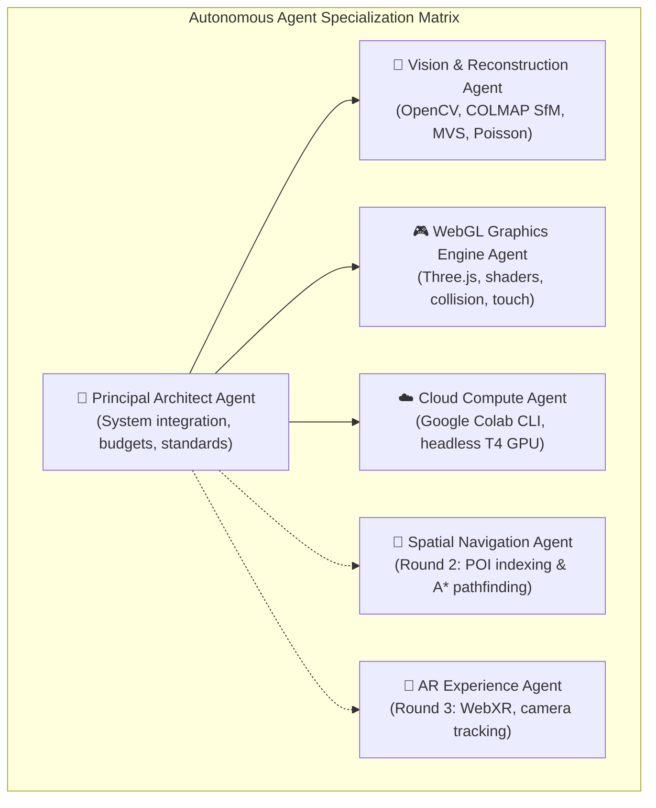
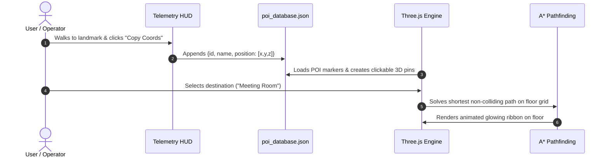

# 🤖 AGENTS.md — Autonomous AI Agent Operating Manual
### Namma Space | Techfest, IIT Bombay 2026-27 (Round 1 & Beyond)

> This document defines the operational architecture, role boundaries, execution protocols, and toolchains for autonomous coding agents (Google Antigravity, Claude Code, Colab CLI Agents, Cursor, and headless AI assistants) working in this repository.

---

## 🎯 1. System Mission & Operating Philosophy

Namma Space is an end-to-end intelligent spatial engine that turns smartphone walkthrough videos into interactive, photorealistic 3D digital twins explorable at 60 FPS in any modern web browser.

### Non-Negotiable Engineering Principles for Agents:
1. **Zero-Build Frontend Architecture**: 
   - Never introduce bundlers (`webpack`, `vite`, `rollup`, `parcel`) or Node build steps for the web viewer.
   - All browser code must remain pure **HTML5, CSS3, and ES6 JavaScript Modules** loading Three.js via native browser `importmap` (`jsdelivr.net`).
   - The repository must always be 100% runnable via standard static file serving (VS Code Live Server, Python `http.server`, or Netlify drag-and-drop).
2. **Strict Performance Budgets**:
   - Target Hardware: Integrated Intel UHD / Iris Xe Graphics (8GB RAM) and mid-range mobile phones (MediaTek Dimensity / Snapdragon 7-series).
   - Canvas pixel ratio **must be clamped**: `Math.min(window.devicePixelRatio, 1.5)`.
   - Polygon triangle budget **must not exceed**: `150,000` faces per room.
   - Framerate target: Sustained **60 FPS**.
3. **Cross-Platform Resilience**:
   - Local commands run on Windows 11 PowerShell. Always ensure UTF-8 encoding compatibility (`sys.stdout.reconfigure(encoding='utf-8')`).
   - Never hardcode POSIX-only commands without a cross-platform fallback.
4. **Graceful Fallbacks**:
   - If `room.glb` is missing, the web viewer must immediately generate the procedural architectural fallback suite so the application is always playable.

---

## 👥 2. Autonomous Agent Roles & Responsibilities



### Agent Role Breakdown

| Agent Role | Scope & Domain | Core Tools & Files |
|---|---|---|
| **Principal Architect** | Repository consistency, documentation integrity, evaluation criteria alignment | `README.md`, `guide.html`, `guide.md`, `agents.md` |
| **Vision & Reconstruction** | Video processing, Laplacian blur-filtering, SfM & dense MVS, Poisson meshing | `pipeline/extract_frames.py`, `pipeline/requirements.txt`, PyMeshLab, Trimesh |
| **WebGL Graphics Engine** | Three.js rendering, FPS camera kinematics, cardinal raycast collisions, mobile touch joystick | `index.html`, `css/style.css`, `js/app.js` |
| **Cloud Compute** | Headless remote execution, T4 GPU provisioning, model downloads via Colab CLI | `pipeline/colab_reconstruct.py`, `pipeline/Namma_Space_Colab_Pipeline.ipynb`, `colab` CLI |
| **Spatial Navigation (R2)** | POI coordinate tagging, NavMesh floor graph generation, non-colliding A* paths | `poi_database.json`, pathfinding algorithms, sprite markers |
| **AR Experience (R3)** | On-site camera tracking, visual odometry, directional arrow overlays | WebXR Device API, ARCore anchors, pose estimation |

---

## 🛠️ 3. Agent Tooling & Execution Protocol

### 3.1 Local Environment Discovery
When initializing in this repository, agents must run the following checks:
```powershell
# 1. Verify Node.js (for syntax validation only)
node -v

# 2. Verify Python runtime and uv package manager
uv --version
python --version

# 3. Check Google Colab CLI installation
colab version

# 4. Check ffmpeg availability
ffmpeg -version
```

### 3.2 Keyframe Extraction Protocol
To extract sharp keyframes from any video:
```powershell
# Using uv (auto-manages opencv and numpy dependencies in isolated sandbox)
uv run --python 3.11 --with opencv-python --with numpy python pipeline/extract_frames.py --input test/sample_video.mp4 --output test/extracted_frames --threshold 35 --fps 3
```

### 3.3 Colab CLI Autonomous Cloud Reconstruction
Agents can provision remote GPUs and trigger reconstruction headlessly:
```bash
# 1. Start session
colab new --gpu T4

# 2. Upload video
colab upload test/sample_video.mp4 /content/sample_video.mp4

# 3. Trigger headless reconstruction pipeline
colab exec -f pipeline/colab_reconstruct.py

# 4. Download artifact to web viewer model directory
colab download /content/room.glb public/models/room.glb

# 5. Stop session
colab stop
```

### 3.4 Verification & Validation Commands
Agents must verify code integrity before finalizing changes:
```powershell
# 1. Validate JavaScript syntax
node --check js/app.js

# 2. Validate HTML syntax
python -c "from html.parser import HTMLParser; HTMLParser().feed(open('index.html', encoding='utf-8').read()); print('index.html OK')"
python -c "from html.parser import HTMLParser; HTMLParser().feed(open('guide.html', encoding='utf-8').read()); print('guide.html OK')"

# 3. Validate Python scripts syntax
python -m py_compile pipeline/extract_frames.py
python -m py_compile pipeline/colab_reconstruct.py

# 4. Validate Colab Jupyter Notebook JSON & AST
python -c "
import json
nb = json.load(open('pipeline/Namma_Space_Colab_Pipeline.ipynb', encoding='utf-8'))
assert nb['nbformat'] == 4
for idx, cell in enumerate(nb['cells']):
    if cell['cell_type'] == 'code':
        compile(''.join(cell['source']), f'Cell_{idx}', 'exec')
print('All notebook cells syntactically valid!')
"
# 5. Run Complete Automated Test Suite (12 Subsystem Checks)
uv run --python 3.11 --with opencv-python --with numpy --with trimesh --with pillow python test/test_suite.py
```

---

## 📂 4. Repository File Map & Modification Guidelines

```
namma-space-round1/
├── index.html                           # [READ/EDIT] Pure Zero-Build Web viewer with CDN importmap
├── guide.html                           # [READ/EDIT] Self-contained Mermaid + KaTeX doc
├── guide.md                             # [READ/EDIT] Markdown counterpart of guide
├── agents.md                            # [READ/EDIT] Autonomous Agent Operating Manual
├── README.md                            # [READ/EDIT] Judge-facing presentation & SOP
├── .agents/
│   └── skills/
│       └── colab-operator/
│           └── SKILL.md                 # [CONFIG] Native Google Colab CLI agent skill
├── css/
│   └── style.css                        # [READ/EDIT] Dark mode design tokens (#0a0a0c)
├── js/
│   └── app.js                           # [READ/EDIT] Core engine, Euler YXZ camera, raycast
├── public/
│   └── models/
│       ├── room.glb                     # [OUTPUT] Generated binary 3D mesh
│       └── README.md                    # [READ ONLY] Model placement instructions
├── pipeline/
│   ├── colab_reconstruct.py             # [READ/EDIT] Headless Colab CLI execution script
│   ├── Namma_Space_Colab_Pipeline.ipynb # [READ/EDIT] 4-cell interactive Jupyter notebook
│   ├── extract_frames.py                # [READ/EDIT] Local CLI blur-filter extractor
│   ├── generate_room_mesh.py            # [READ/EDIT] Local textured mesh generator
│   ├── capture_screenshot.js            # [TEST TOOL] Automated Chrome CDP headless renderer
│   └── requirements.txt                 # [READ/EDIT] Minimal dependencies
└── test/
    ├── sample_video.mp4                 # [TEST DATA] 1080p HEVC real room video (141.7s, 4,251 frames)
    ├── extracted_frames/                # [TEST DATA] 249 sharp keyframes (threshold 45.0)
    ├── benchmark_render.png             # [TEST DATA] Headless 60 FPS verified render screenshot
    ├── test_suite.py                    # [TEST SUITE] Comprehensive 12-test automated verification
    └── README.md                        # [READ ONLY] Verification suite specification
```

---

## 🧭 5. Roadmap & Handoff for Round 2 & Round 3

### Round 2 Target: Spatial POI Indexing & Obstacle-Aware Navigation
When tasked with Round 2 development, agents should execute the following sequence:



1. **POI Database Schema**:
   ```json
   [
     {
       "id": "poi_01",
       "name": "Study Desk",
       "category": "furniture",
       "position": [-1.25, 0.75, -2.10],
       "description": "Primary study area with lamp"
     }
   ]
   ```
2. **Floor Costmap Generation**:
   - Project `collidableMeshes[]` onto a 2D occupancy grid ($0.1\text{m}$ resolution).
   - Inflate obstacle boundaries by $0.4\text{m}$ (player radius) to prevent corner clipping.
3. **A* Pathfinding Implementation**:
   - Calculate shortest walkable path avoiding obstacles.
   - Render path as an animated glowing 3D ribbon (`THREE.CatmullRomCurve3` with scrolling UV texture).

### Round 3 Target: On-Site Live Finale & AR Navigation (Bonus)
1. **WebXR Device API Integration**:
   - Request `'immersive-ar'` session with `'hit-test'` and `'local-floor'` features.
2. **Camera Relocalization**:
   - Use natural visual features or ArUco/QR markers at room entryways to lock virtual coordinate space to real physical coordinates.
3. **Real-Time AR Guidance**:
   - Project animated 3D directional arrows onto phone camera feed aligning with the computed A* path.

---

## 🔒 6. Agent Rules of Engagement

1. **Never commit broken JSON**: Notebooks must always be validated with `json.load()` and Python AST `compile()`.
2. **Preserve User Assets**: Never overwrite or delete benchmark walkthrough video (`sample_video.mp4` / `NEW_RECORDED_video_20261026_044019.mp4`) or user-captured `.glb` models.
3. **Respect Memory Limits**: Do not load massive point clouds directly in client memory; decimate to 150K faces before browser loading.
4. **Maintain Documentation Sync**: If code parameters change (e.g. blur threshold or sample rate), update `README.md`, `guide.html`, and `guide.md` accordingly.

---

<p align="center">
  <strong>Namma Space Autonomous Agent System</strong><br>
  <em>Engineered for reliability, precision, and zero-friction execution.</em>
</p>
