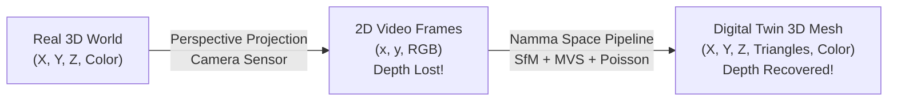
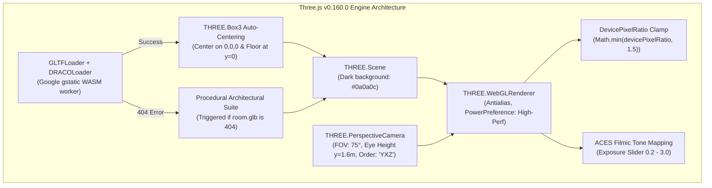
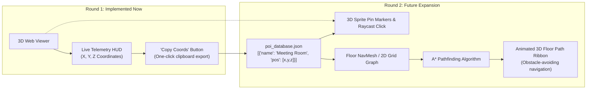

# 🌐 Namma Space: Complete Engineering & Architectural Guide
### From First Principles to Production 3D Digital Twins | Techfest, IIT Bombay 2026-27

---

<div align="center">
  <p><strong>An exhaustive, layman-to-advanced deep-dive into Photogrammetry, Structure-from-Motion (SfM), Multi-View Stereo (MVS), Screened Poisson Surface Reconstruction, and Real-Time Three.js WebGL Engine Design.</strong></p>
  <p>
    <span style="background: #1e1e24; color: #4fc3f7; padding: 4px 10px; border-radius: 4px; border: 1px solid rgba(79,195,247,0.3); font-family: monospace; font-size: 11px;">Techfest IIT Bombay</span>
    &nbsp;
    <span style="background: #1e1e24; color: #66bb6a; padding: 4px 10px; border-radius: 4px; border: 1px solid rgba(102,187,106,0.3); font-family: monospace; font-size: 11px;">Round 1 Submission</span>
    &nbsp;
    <span style="background: #1e1e24; color: #ffa726; padding: 4px 10px; border-radius: 4px; border: 1px solid rgba(255,167,38,0.3); font-family: monospace; font-size: 11px;">Zero-Install WebGL</span>
    &nbsp;
    <span style="background: #1e1e24; color: #ab47bc; padding: 4px 10px; border-radius: 4px; border: 1px solid rgba(171,71,188,0.3); font-family: monospace; font-size: 11px;">COLMAP + Poisson</span>
  </p>
</div>

---

## 📑 Table of Contents

1. [Executive Summary & Problem Statement](#1-executive-summary--problem-statement)
2. [High-Level System Architecture](#2-high-level-system-architecture)
3. [Phase 1: Smartphone Capture & Optical Physics](#3-phase-1-smartphone-capture--optical-physics)
4. [Phase 2: Intelligent Keyframe Filtering (OpenCV Laplacian)](#4-phase-2-intelligent-keyframe-filtering-opencv-laplacian)
5. [Phase 3: Structure-from-Motion (COLMAP SfM)](#5-phase-3-structure-from-motion-colmap-sfm)
6. [Phase 4: Dense Reconstruction (PatchMatch Stereo & MVS)](#6-phase-4-dense-reconstruction-patchmatch-stereo--mvs)
7. [Phase 5: Surface Meshing (Screened Poisson & Decimation)](#7-phase-5-surface-meshing-screened-poisson--decimation)
8. [Phase 6: Format Conversion & 3D Serialization (Trimesh to GLB)](#8-phase-6-format-conversion--3d-serialization-trimesh-to-glb)
9. [Phase 7: Real-Time 3D Web Engine (Three.js WebGL Architecture)](#9-phase-7-real-time-3d-web-engine-threejs-webgl-architecture)
10. [Phase 8: Player Physics, Collision & Mobile Touch Controls](#10-phase-8-player-physics-collision--mobile-touch-controls)
11. [Hardware Optimization & Zero-Build Strategy](#11-hardware-optimization--zero-build-strategy)
12. [Bridge to Round 2: Spatial Indexing & Indoor Navigation](#12-bridge-to-round-2-spatial-indexing--indoor-navigation)

---

## 1. Executive Summary & Problem Statement

### The Layman's Intuition
Imagine walking into a massive Ikea store, an airport terminal, or a university lecture complex like IIT Bombay's LHC. You are given a paper blueprint or a 2D floor map on your phone. Blueprints fail because humans do not experience spaces in 2D top-down orthogonal projections; we experience them in **first-person perspective** with depth, landmarks, lighting, and occlusions.

**Namma Space** bridges this divide:
> *Can an everyday user record a simple 2-minute smartphone video of their room, click a single button, and turn that space into a fully navigable, video-game-like 3D digital twin accessible from any browser on Earth?*

### The Engineering Challenge
Converting a flat 2D video (a series of RGB pixel grids) into a mathematically accurate, physically traversable 3D world is an **ill-posed inverse computer vision problem**. A 2D camera flattens the 3D world by projecting rays through a focal lens onto a 2D sensor array, losing depth ($Z$). To reconstruct depth, we must mathematically reverse the camera projection matrix across hundreds of overlapping viewpoints using projective geometry.



---

## 2. High-Level System Architecture

The Namma Space architecture is split into two decoupled layers:
1. **The Cloud Compute Pipeline (Google Colab T4 GPU)**: Handles heavy numeric tensor processing, SIFT feature extraction, non-linear bundle adjustment, depth map estimation, and Poisson partial differential equation meshing.
2. **The Client-Side 3D Web Viewer (Netlify / Static CDN)**: Handles real-time WebGL rendering at 60 FPS, collision detection, responsive desktop/mobile inputs, and dynamic asset management with zero install requirements.

```mermaid
flowchart TD
    subgraph DataCollection["📱 1. DATA CAPTURE LAYER"]
        A1["User with Smartphone\n(Vivo T3 5G / iPhone / Pixel)"] --> A2["Follow Capture SOP\n(AE/AF locked, EIS off, crab-walk)"]
        A2 --> A3["Indoor Walkthrough MP4\n(1080p, 30 FPS, ~2-3 mins)"]
    end

    subgraph ColabPipeline["☁️ 2. CLOUD COMPUTE RECONSTRUCTION (Colab T4 GPU)"]
        B1["OpenCV Laplacian Variance Filter"] -->|Discard motion-blurred frames| B2["Sharp Keyframe Set\n(workspace/images @ 2 FPS)"]
        B2 --> B3["COLMAP GPU SIFT Extraction\n(Scale-space extrema detection)"]
        B3 --> B4["COLMAP Sequential Matcher\n(Epipolar geometry + Loop detection)"]
        B4 --> B5["Sparse Reconstruction (Mapper)\n(Bundle Adjustment + Camera Poses)"]
        B5 --> B6["Dense Stereo (PatchMatch CUDA)\n(Photometric & geometric depth estimation)"]
        B6 --> B7["Stereo Fusion\n(Point cloud with normals: fused.ply)"]
        B7 --> B8["PyMeshLab Screened Poisson\n(Solving Poisson PDE for indicator field)"]
        B8 --> B9["Quadric Edge Collapse Decimation\n(Reduce to 150K triangles budget)"]
        B9 --> B10["Trimesh Binary GLB Packaging\n(Embed vertex colors COLOR_0)"]
    end

    subgraph WebDelivery["🌐 3. ZERO-INSTALL CLIENT DELIVERY (Netlify)"]
        C1["Static Asset Host\n(index.html, style.css, app.js)"] --> C2["Browser WebGL Context\n(Three.js v0.160.0 via CDN importmap)"]
        C2 --> C3["GLTFLoader + DRACOLoader\n(Asynchronously fetches room.glb)"]
        C3 -->|404 Fallback| C4["Procedural Architectural Suite\n(Fallback demo room)"]
        C3 -->|Success| C5["Auto-Centering & Floor Alignment\n(THREE.Box3 calculation)"]
        C5 --> C6["Collision & Floor-Snapping Engine\n(Cardinal horizontal & downward raycasters)"]
        C6 --> C7["Dual Input Manager\n(Desktop WASD/Mouse OR Mobile Touch Joystick)"]
        C7 --> C8["Real-Time 60 FPS Telemetry HUD\n(FPS, X/Y/Z Coordinates, GLB Hot-Swapper)"]
    end

    A3 --> B1
    B10 -->|room.glb| C1
```



---

## 3. Phase 1: Smartphone Capture & Optical Physics

### Why Do Typical Smartphone Videos Fail Photogrammetry?
If an untrained person walks through a room filming with a phone, the reconstruction will almost certainly fail or turn into unrecognizable "soup." Here is why:

<table style="width: 100%; border-collapse: collapse; margin: 16px 0;">
  <thead>
    <tr style="background: rgba(255,255,255,0.05); text-align: left;">
      <th style="padding: 10px; border-bottom: 1px solid rgba(255,255,255,0.1);">Optical Problem</th>
      <th style="padding: 10px; border-bottom: 1px solid rgba(255,255,255,0.1);">Physical Mechanism</th>
      <th style="padding: 10px; border-bottom: 1px solid rgba(255,255,255,0.1);">Disaster for Computer Vision</th>
      <th style="padding: 10px; border-bottom: 1px solid rgba(255,255,255,0.1);">SOP Solution</th>
    </tr>
  </thead>
  <tbody>
    <tr>
      <td style="padding: 10px; border-bottom: 1px solid rgba(255,255,255,0.05);"><strong>Auto-Exposure Hunting</strong></td>
      <td>Phone continuously adjusts ISO and shutter speed as light levels change.</td>
      <td>The exact same wall point has different RGB values in frame 10 vs frame 12, breaking photometric consistency.</td>
      <td><strong>Lock Auto-Exposure (AE Lock)</strong> on a medium-brightness zone before recording.</td>
    </tr>
    <tr>
      <td style="padding: 10px; border-bottom: 1px solid rgba(255,255,255,0.05);"><strong>Auto-Focus Breathing</strong></td>
      <td>Lens elements physically move to refocus on near/far objects.</td>
      <td>Changes the camera's internal focal length ($f_x, f_y$), destroying the pinhole camera calibration model.</td>
      <td><strong>Lock Auto-Focus (AF Lock)</strong> at ~2 meters fixed distance.</td>
    </tr>
    <tr>
      <td style="padding: 10px; border-bottom: 1px solid rgba(255,255,255,0.05);"><strong>Electronic Stabilization (EIS)</strong></td>
      <td>Software dynamically crops, rotates, and non-linearly warps frames to look "smooth".</td>
      <td>Warps straight physical geometry into curved approximations, violating epipolar line constraints.</td>
      <td><strong>Disable EIS / Action Mode</strong> in camera settings.</td>
    </tr>
    <tr>
      <td style="padding: 10px; border-bottom: 1px solid rgba(255,255,255,0.05);"><strong>Blank White Walls</strong></td>
      <td>Modern drywall has virtually zero high-frequency pixel texture.</td>
      <td>SIFT feature detector cannot find gradients or corners to track across views.</td>
      <td><strong>Place 3–5 colorful sticky notes</strong> on plain walls as temporary geometric anchors.</td>
    </tr>
    <tr>
      <td style="padding: 10px; border-bottom: 1px solid rgba(255,255,255,0.05);"><strong>Pure Rotational Panning</strong></td>
      <td>User stands in the center and spins the phone around like a panorama.</td>
      <td>Zero parallax baseline ($T = 0$). Triangulation angle is $0^\circ$, making depth mathematically unsolvable.</td>
      <td><strong>Crab-walk along room perimeter</strong> (translational motion) keeping camera oriented towards walls.</td>
    </tr>
  </tbody>
</table>

### The Multi-Height Walkthrough Pattern
Our Standard Operating Procedure (SOP) specifies a **dual-height perimeter loop**:
1. **Pass 1 (Eye Level ~1.6m)**: Captures upper walls, door headers, light fixtures, and ceiling boundaries.
2. **Pass 2 (Waist Level ~0.9m)**: Captures floor transitions, baseboards, table surfaces, and chair legs.
3. **Pass 3 (Diagonal cross-room traversal)**: Ties both loops together and anchors opposite room walls into a single coordinate frame.

---

## 4. Phase 2: Intelligent Keyframe Filtering (OpenCV Laplacian)

### Layman's Intuition
A 3-minute video at 30 FPS contains $3 \times 60 \times 30 = 5,400$ frames. Running photogrammetry on 5,400 frames would take 18 hours on a GPU and run out of memory. Furthermore, when the person turns a corner quickly, motion blur turns crisp doorframes into smudges. Feeding blurry images to an SfM pipeline poisons the math.

We must automatically extract only the **sharpest frames** at a controlled interval (~2 FPS, resulting in ~300 high-quality frames).

### Mathematical Deep-Dive: The Discrete Laplacian Operator
How does a computer determine whether an image is "blurry" without human eyes?

Edges in an image are sharp transitions in pixel intensity. Mathematically, an intensity transition is a rapid change in the first derivative (gradient $\nabla I$), which corresponds to a **zero-crossing and extreme peak in the second derivative**.

The 2D continuous Laplacian operator $\Delta I$ is defined as the sum of second partial derivatives:
$$\Delta I = \frac{\partial^2 I}{\partial x^2} + \frac{\partial^2 I}{\partial y^2}$$

In discrete digital image processing, this is computed by convolving the grayscale image $I$ with a discrete $3 \times 3$ kernel:
$$K = \begin{bmatrix} 0 & 1 & 0 \\ 1 & -4 & 1 \\ 0 & 1 & 0 \end{bmatrix} \quad \text{or} \quad K = \begin{bmatrix} 1 & 1 & 1 \\ 1 & -8 & 1 \\ 1 & 1 & 1 \end{bmatrix}$$

```
Sharp Image (High contrast edges)        Blurry Image (Smooth transitions)
Intensity: [0, 0, 0, 255, 255, 255]       Intensity: [0, 40, 80, 120, 160, 200]
1st Deriv: [0, 0, 255,   0,   0]          1st Deriv: [40, 40,  40,  40,  40]
2nd Deriv: [0, 255, -255, 0]              2nd Deriv: [0,   0,   0,   0]
-> Variance of 2nd Deriv is HUGE!          -> Variance of 2nd Deriv is NEAR ZERO!
```

The sharpness score is simply the **variance** of the response matrix:
$$\text{Score} = \text{Var}(\Delta I) = \frac{1}{N} \sum_{x, y} \left( \Delta I(x, y) - \mu \right)^2$$

### Code Implementation (`pipeline/extract_frames.py`)
```python
def compute_blur_score(frame):
    # 1. Convert to grayscale (color is irrelevant to edge frequency)
    gray = cv2.cvtColor(frame, cv2.COLOR_BGR2GRAY)
    
    # 2. Convolve with Laplacian using 64-bit float to prevent integer overflow
    laplacian = cv2.Laplacian(gray, cv2.CV_64F)
    
    # 3. Calculate variance of the second derivative
    return laplacian.var()
```
- **Threshold selection**: A clean smartphone photo with indoor lighting scores $\approx 120 - 450$. Motion-blurred frames score $\le 45$. We set our threshold to **`60.0`**, reliably rejecting blurry frames while keeping good views.
- **Downscaling**: Images are resized to **`1280px` max width**. At 1280px, SIFT feature extraction is $3\times$ faster than native 4K while preserving all structural geometric corners.

---

## 5. Phase 3: Structure-from-Motion (COLMAP SfM)

### Layman's Intuition
How do humans perceive 3D when looking with two eyes? Your left eye and right eye see two slightly different 2D pictures. Your brain matches the lamp seen by the left eye with the lamp seen by the right eye, measures the angle difference, and calculates how far away the lamp is.

**Structure-from-Motion (SfM)** does this with hundreds of camera positions taken over time by a single moving phone.

```
       [Camera 1]                        [Camera 2]
           \                                 /
            \       Epipolar Line           /
             \-----------------------------/
              \                           /
               \      Ray Intersection   /
                \           ▼           /
                 \       [ Point P ]   /
                  \      (X, Y, Z)    /
```

### Step 3.1: SIFT Feature Extraction (GPU Accelerated)
SIFT (Scale-Invariant Feature Transform) finds visual "landmarks" (corners, speckles, logos) that look identical regardless of distance, angle, or minor lighting changes.

1. **Scale-Space Construction**: Convolves the image with Gaussians at multiple scales ($\sigma, k\sigma, k^2\sigma$) and computes **Difference-of-Gaussians (DoG)**:
   $$D(x, y, \sigma) = (G(x, y, k\sigma) - G(x, y, \sigma)) * I(x, y)$$
2. **Keypoint Localization**: Identifies local extrema in 3D scale-space (comparing a pixel to its 26 neighbors across scales) and discards low-contrast points.
3. **Descriptor Generation**: Computes gradient magnitudes and directions in a $16 \times 16$ neighborhood around each keypoint, binning them into an **8-orientation histogram** across $4 \times 4$ sub-regions. This yields a **128-dimensional vector** for every keypoint.
4. **Colab Flag**: `--SiftExtraction.use_gpu 1` executes feature detection via CUDA on the Tesla T4, processing ~15 frames per second.

### Step 3.2: Sequential Matching with Loop Detection
Comparing every image to every other image ($N \times (N-1)/2$) for 300 frames requires $\sim 45,000$ image-pair comparisons. Because video frames are sequential, we use **Sequential Matching**:
- Frame $i$ is compared only to frames $i \pm 5$.
- `--SequentialMatching.loop_detection 1`: Crucially, when the user finishes walking around the room and returns to the doorway where they began, the pipeline detects that Frame 290 matches Frame 2. It closes the mathematical loop, preventing **corridor drift** (where a rectangular room erroneously turns into an open spiral).

### Step 3.3: Triangulation & Epipolar Geometry
For two matched images, their camera coordinate systems are related by a Rotation matrix $R \in SO(3)$ and a Translation vector $T \in \mathbb{R}^3$. The algebraic relationship between corresponding points in normalized coordinates $x_1$ and $x_2$ is governed by the **Essential Matrix ($E$)**:
$$x_2^T E x_1 = 0 \quad \text{where} \quad E = [T]_\times R$$

Using the **Five-Point Algorithm** inside a **RANSAC (Random Sample Consensus)** loop, COLMAP rejects false feature matches and recovers relative camera poses.

### Step 3.4: Bundle Adjustment (Levenberg-Marquardt Optimization)
Once initial points are triangulated, small calibration errors accumulate. Bundle Adjustment refines all 3D point positions $X_j$ and all camera parameters $P_i = \{R_i, T_i, f_i\}$ simultaneously by minimizing the total **Reprojection Error**:
$$\min_{P_i, X_j} \sum_{i} \sum_{j} \rho \left( \| x_{ij} - \pi(P_i, X_j) \|^2 \right)$$
where $x_{ij}$ is the observed 2D feature, $\pi()$ is the pinhole projection function, and $\rho()$ is a robust Cauchy loss function that ignores outliers.

**Output of Phase 3**: A **sparse point cloud** (tens of thousands of floating points representing sharp corners) and exact 6-DoF trajectory coordinates for every camera frame.

---

## 6. Phase 4: Dense Reconstruction (PatchMatch Stereo & MVS)

### Layman's Intuition
The sparse point cloud from Phase 3 only contains corners (e.g., the edge of a table or the pattern on a rug). Blank walls and flat tabletop surfaces have no SIFT corners, so they look completely hollow—like a ghost world of dots.

**Dense Multi-View Stereo (MVS)** fills in every single pixel by calculating a depth value for all points in every image, turning empty air into solid surfaces.

```
Sparse Cloud:  *              *         (Only corners detected by SIFT)
Dense MVS:     ************************* (Every pixel has estimated depth)
```

### How PatchMatch Stereo Works Under the Hood
COLMAP's dense reconstruction implements the state-of-the-art **PatchMatch Stereo** algorithm accelerated by CUDA:

1. **Random Hypothesis Initialization**: For every pixel in an image, randomly assign a 3D plane hypothesis defined by depth $d$ and surface normal vector $\vec{n}$.
2. **Spatial & Temporal Propagation**: If pixel $(x, y)$ has a correct depth estimate, its spatial neighbors $(x+1, y)$ and temporal neighbors in nearby video frames likely share a very similar plane. The algorithm propagates good hypotheses across the image grid.
3. **Photometric Consistency Matching**: To evaluate if a depth $d$ is correct, COLMAP projects a small rectangular window (e.g., $5 \times 5$ pixels) from the source image into neighboring images along the candidate 3D plane. It computes the **Normalized Cross-Correlation (NCC)**:
   $$\text{NCC}(W_1, W_2) = \frac{\sum (W_1 - \bar{W}_1)(W_2 - \bar{W}_2)}{\sqrt{\sum (W_1 - \bar{W}_1)^2 \sum (W_2 - \bar{W}_2)^2}}$$
4. **Geometric Consistency Filtering (`geom_consistency=true`)**: A depth estimate at pixel $p$ in camera A is only accepted if re-projecting it into camera B and back into camera A lands within $<1$ pixel of $p$. This eliminates fake depth points caused by reflections and glare.
5. **Stereo Fusion**: Combines hundreds of validated depth maps into a single cohesive, high-density point cloud: **`fused.ply`** (containing 1 to 5 million points with surface normal vectors $\vec{n}_x, \vec{n}_y, \vec{n}_z$ and RGB color).

---

## 7. Phase 5: Surface Meshing (Screened Poisson & Decimation)

### Layman's Intuition: Point Cloud vs. 3D Mesh
A point cloud is like a cloud of colored sand floating in dark space. If you walk inside a point cloud in a 3D web viewer, you can see right through the walls, light cannot bounce off surfaces, and there are no solid planes for raycast collision detection.

To make an interactive walkthrough, we must "shrink-wrap" a continuous watertight skin of **triangles (faces)** over the points.

```
Point Cloud:     .  .  .  .  .  .  .  (Disconnected dots, cannot collide)
Polygon Mesh:    ├──┼──┼──┼──┼──┼──┤  (Connected triangles, solid surface)
```

### The Math: Screened Poisson Surface Reconstruction
Michael Kazhdan's Screened Poisson algorithm converts surface reconstruction into an implicit spatial partial differential equation.

1. **Indicator Function**: Consider an unknown 3D scalar field $\chi: \mathbb{R}^3 \to \mathbb{R}$ that equals $1$ inside the room/objects and $0$ outside.
2. **Gradient Relationship**: The gradient of this indicator function $\nabla \chi$ is zero everywhere except directly on the room boundaries, where it forms an inward-pointing vector field matching our point cloud normals $\vec{V}$.
3. **The Poisson Equation**: Taking the divergence of both sides yields the classical Poisson equation:
   $$\Delta \chi \equiv \nabla \cdot \nabla \chi = \nabla \cdot \vec{V}$$
4. **Screening Term**: Classical Poisson often over-smoothes fine details. *Screened* Poisson adds a spatial regularization constraint requiring the isosurface to pass directly through the original input points:
   $$\min_{\chi} \left( \int_{\Omega} \|\nabla \chi - \vec{V}\|^2 + \lambda \sum_{s \in \text{Points}} |\chi(s)|^2 \right)$$
5. **Octree Discretization**: The continuous space is divided into an adaptive Octree of depth **`9`** ($2^9 = 512$ voxel resolution).
6. **Iso-Surface Extraction**: The **Marching Cubes** algorithm extracts the polygonal triangle mesh where $\chi(x, y, z) = 0.5$.

```
[Dense Points with Normals] ──▶ [Octree Depth 9] ──▶ [Solve Δχ = ∇·V] ──▶ [Marching Cubes] ──▶ [Watertight 3D Mesh]
```

### Mesh Decimation (Quadric Error Metrics)
The initial Poisson reconstruction produces $1,500,000$ to $3,000,000$ tiny polygons. 
- **The Problem**: A mobile phone (Vivo T3 5G) or integrated graphics laptop (Intel UHD/Iris Xe) will drop to 8 FPS or crash due to WebGL memory exhaustion if forced to render 2 million polygons with real-time shadow matrices.
- **The Solution**: We apply **Quadric Edge Collapse Decimation** via `pymeshlab` to decimate the mesh down to an optimal budget of **`150,000` triangles**.

```python
# Reduces geometry by ~90% while keeping sharp architectural edges intact
ms.meshing_decimation_quadric_edge_collapse(
    targetfacenum=150000,
    preservenormal=True
)
```

**How Garland-Heckbert Quadric Error Simplification Works**:
Each vertex $v$ is assigned an error matrix $Q$:
$$Q = \sum_{p \in \text{Planes}(v)} p \cdot p^T$$
When an edge $(v_1, v_2)$ is contracted into a single vertex $\bar{v}$, the geometric cost $\Delta(\bar{v}) = \bar{v}^T (Q_1 + Q_2) \bar{v}$ measures how much the new surface deviates from the original planes. Edges on flat walls cost almost zero and collapse first; edges defining sharp table corners or door frames have high error costs and are preserved.

---

## 8. Phase 6: Format Conversion & 3D Serialization (Trimesh to GLB)

### Why `.glb` Over `.obj`, `.stl`, or `.ply`?

<table style="width: 100%; border-collapse: collapse; margin: 16px 0;">
  <thead>
    <tr style="background: rgba(255,255,255,0.05); text-align: left;">
      <th style="padding: 10px; border-bottom: 1px solid rgba(255,255,255,0.1);">Format</th>
      <th style="padding: 10px; border-bottom: 1px solid rgba(255,255,255,0.1);">File Type</th>
      <th style="padding: 10px; border-bottom: 1px solid rgba(255,255,255,0.1);">File Size (150K faces)</th>
      <th style="padding: 10px; border-bottom: 1px solid rgba(255,255,255,0.1);">Embedded Colors?</th>
      <th style="padding: 10px; border-bottom: 1px solid rgba(255,255,255,0.1);">Browser Parsing Speed</th>
    </tr>
  </thead>
  <tbody>
    <tr>
      <td style="padding: 10px; border-bottom: 1px solid rgba(255,255,255,0.05);"><strong>.OBJ</strong></td>
      <td>ASCII text</td>
      <td>~48 MB</td>
      <td>No (needs separate .mtl + textures)</td>
      <td>Slow (JavaScript string parsing)</td>
    </tr>
    <tr>
      <td style="padding: 10px; border-bottom: 1px solid rgba(255,255,255,0.05);"><strong>.PLY</strong></td>
      <td>Binary / ASCII</td>
      <td>~24 MB</td>
      <td>Yes (raw vertex colors)</td>
      <td>Moderate (no standard scene hierarchy)</td>
    </tr>
    <tr>
      <td style="padding: 10px; border-bottom: 1px solid rgba(255,255,255,0.05);"><strong>.GLB (Binary glTF)</strong></td>
      <td>Binary Container</td>
      <td><strong>~11 MB</strong></td>
      <td><strong>Yes (`COLOR_0` buffer accessor)</strong></td>
      <td><strong>Instant (Direct GPU memory upload)</strong></td>
    </tr>
  </tbody>
</table>

### How GLB Works
`GLB` is the "JPEG of 3D". It packs:
1. A **JSON chunk** defining scene nodes, cameras, mesh indices, and material definitions.
2. A **Binary buffer chunk** containing raw binary IEEE 754 float arrays for vertex coordinates, normals, and color channels. The browser reads these bytes directly into WebGL ArrayBuffers with zero CPU string-parsing overhead.

```python
# Export script in Cell 4
mesh = trimesh.load('workspace/room.ply', force='mesh')
glb_data = mesh.export(file_type='glb')
with open('room.glb', 'wb') as f:
    f.write(glb_data)
```

---

## 9. Phase 7: Real-Time 3D Web Engine (Three.js WebGL Architecture)

### The Zero-Build Vanilla Stack
Modern web development often requires bulky Node.js toolchains (`npm install`, `webpack`, `vite`, `node_modules` totaling 600 MB). If a Techfest judge clones a repository that fails to build due to mismatched Node versions, the submission fails on the spot.

**Our Architectural Decision**:
We utilize **native ES6 module import maps** loading Three.js v0.160.0 directly via CDN:
```html
<script type="importmap">
{
    "imports": {
        "three": "https://cdn.jsdelivr.net/npm/three@0.160.0/build/three.module.js",
        "three/addons/": "https://cdn.jsdelivr.net/npm/three@0.160.0/examples/jsm/"
    }
}
</script>
```
This guarantees that **anyone can run the project instantly** by double clicking or running VS Code Live Server, while maintaining clean modular code.



### Auto-Centering & Normalization Math
When photogrammetry exports a mesh, its coordinate origin $(0, 0, 0)$ is arbitrary—usually the position where the smartphone was when recording began. If the user started filming while holding the phone 10 meters away, loading the model would place the room far off-screen.

In `js/app.js`, we compute the **Axis-Aligned Bounding Box (AABB)**:
```javascript
const box = new THREE.Box3().setFromObject(model);
const center = box.getCenter(new THREE.Vector3());

// Shift model so its spatial center is exactly at (0, 0, 0)
model.position.x -= center.x;
model.position.z -= center.z;

// Shift model so its lowest point (floor) rests exactly on y = 0
model.position.y -= box.min.y;
```

### The Procedural Fallback Suite
To make the web viewer 100% playable even before the user uploads a photogrammetry scan, we built an architectural interior generator directly into `js/app.js`:
- **Floor**: $20 \text{m} \times 20 \text{m}$ plane with a custom coordinate grid overlay.
- **Architectural Walls**: Segmented wall geometries with doorway cutouts.
- **Structural Columns**: 4 cylindrical pillars positioned symmetrically.
- **Conference Room Furniture**: A meeting table with 6 chairs.
- **Lighting Fixtures**: Overhead fluorescent panel meshes with simulated point light sources.
- Every single procedural object is registered in `collidableMeshes[]` so collision detection works immediately.

---

## 10. Phase 8: Player Physics, Collision & Mobile Touch Controls

### 1. Camera Rotation Mechanics & Gimbal Lock Prevention
In first-person games, pitching the camera up/down and yawing left/right can lead to **Gimbal Lock** if Euler rotation orders are not carefully managed. 

By default, Three.js uses `'XYZ'` rotation order. If the player looks straight up, the X and Z axes align, causing wild roll twisting.
**The Fix**:
```javascript
camera.rotation.order = 'YXZ'; // Yaw applied first around global Y, then pitch around local X
```
We clamp the vertical pitch angle between $-80^\circ$ and $+80^\circ$ ($-1.396$ to $+1.396$ radians) so the player cannot invert their neck.

### 2. Velocity-Damped Smooth Locomotion
Instead of teleporting the player or using rigid discrete key steps, we implement an **inertial damping model**:
```javascript
// Each frame:
const targetVelocity = new THREE.Vector3();
targetVelocity.addScaledVector(forwardVector, inputZ * speed);
targetVelocity.addScaledVector(rightVector, inputX * speed);

// Exponential damping (0.85 retention per frame)
velocity.lerp(targetVelocity, 1 - 0.85);

// Apply displacement: Δp = v * Δt
camera.position.addScaledVector(velocity, dt);
```
This produces a smooth, human walkthrough sensation without motion sickness.

### 3. Raycast Collision Detection & Obstacle Sliding
How do we prevent the player from walking through photogrammetry walls?

```
      [Camera Pos]
           │
           ├──▶ Horizontal Ray (far = 0.45m) ──▶ [Wall Detected!] ──▶ Zero out normal velocity
           │
           └──▼ Downward Ray (from y + 10m)  ──▶ [Floor Hit at y=0.0m] ──▶ Set eye level to 1.6m
```

#### Obstacle Sliding Algorithm
If a user walks diagonally into a north-facing wall, a naive collision check stops all movement. Our engine decouples horizontal axes:
1. We project the player's intended movement onto the **X axis** and cast a ray `0.45m` in direction $(\text{sign}(dx), 0, 0)$.
2. If it hits an obstacle, we set $dx = 0$, but let $dz$ continue.
3. We project movement onto the **Z axis** and cast a ray in direction $(0, 0, \text{sign}(dz))$.
4. If it hits an obstacle, we set $dz = 0$.
**Result**: The player smoothly slides along walls instead of sticking to them.

#### Continuous Floor Snapping
Photogrammetry scans are rarely perfectly flat; floors have slight slopes and steps.
- We cast a downward ray from $(x, y+10, z)$ straight down $(0, -1, 0)$ against all `collidableMeshes`.
- When an intersection point $(x_{\text{hit}}, y_{\text{hit}}, z_{\text{hit}})$ is found, the target camera height is $y_{\text{target}} = y_{\text{hit}} + 1.6\text{m}$.
- We interpolate `camera.position.y` smoothly using exponential lerp:
  $$\text{cam}_y \leftarrow \text{cam}_y + (y_{\text{target}} - \text{cam}_y) \times 0.2$$

#### No-Clip / Free-Fly Mode (`Key F` / HUD Button)
Photogrammetry meshes sometimes have internal "ghost triangles" (floating reconstruction noise). If a player gets trapped inside an artifact, they can press `F` to activate **No-Clip Mode**:
- Disables wall collision tests.
- Disables downward floor-snapping.
- Enables vertical flight (`Space` to ascend, `Ctrl` to descend).

### 4. Custom Mobile Virtual Joystick & Touch Look
Rather than loading an external 80KB joystick library, we engineered a zero-dependency touch system directly in `js/app.js`:

```
┌───────────────────────────────────────┬───────────────────────────────────────┐
│           LEFT SCREEN HALF            │           RIGHT SCREEN HALF           │
│                                       │                                       │
│          ╭──────────────╮             │          Touch & Drag Finger          │
│          │   (Knob)     │             │                   ▲                   │
│          │      ●       │             │                   │ Pitch             │
│          ╰──────────────╯             │             ◀─────┼─────▶ Yaw         │
│          Virtual Joystick             │                   │                   │
│    (Strafe X, Move Forward/Back Z)    │                   ▼                   │
└───────────────────────────────────────┴───────────────────────────────────────┘
```

1. **Touch Partitioning**:
   - Touches starting inside `#joystick-zone` (bottom-left) capture `joystickTouchId`.
   - Touches starting on the right $65\%$ of the canvas capture `lookTouchId`.
2. **Radial Clamping**:
   $$\Delta x = x_{\text{touch}} - x_{\text{center}}, \quad \Delta y = y_{\text{touch}} - y_{\text{center}}$$
   $$\text{distance} = \sqrt{\Delta x^2 + \Delta y^2}$$
   If $\text{distance} > R_{\text{max}}$ ($50\text{px}$), the displacement is clamped to the outer circle boundary:
   $$\Delta x \leftarrow \Delta x \cdot \frac{R_{\text{max}}}{\text{distance}}, \quad \Delta y \leftarrow \Delta y \cdot \frac{R_{\text{max}}}{\text{distance}}$$
   Normalized values $(-1.0 \text{ to } +1.0)$ are fed into the velocity integrator.

---

## 11. Hardware Optimization & Zero-Build Strategy

### Target Hardware Profiles

<table style="width: 100%; border-collapse: collapse; margin: 16px 0;">
  <thead>
    <tr style="background: rgba(255,255,255,0.05); text-align: left;">
      <th style="padding: 10px; border-bottom: 1px solid rgba(255,255,255,0.1);">Device</th>
      <th style="padding: 10px; border-bottom: 1px solid rgba(255,255,255,0.1);">Hardware Specs</th>
      <th style="padding: 10px; border-bottom: 1px solid rgba(255,255,255,0.1);">Bottleneck</th>
      <th style="padding: 10px; border-bottom: 1px solid rgba(255,255,255,0.1);">Our Optimization Strategy</th>
    </tr>
  </thead>
  <tbody>
    <tr>
      <td style="padding: 10px; border-bottom: 1px solid rgba(255,255,255,0.05);"><strong>Local Laptop</strong><br>(ASUS Vivobook 15)</td>
      <td>Intel Core i3-1215U, 8GB RAM, Intel UHD Graphics</td>
      <td>Shared memory fill-rate, weak integrated GPU fragment shaders</td>
      <td>
        • Cap pixel ratio: <code>Math.min(window.devicePixelRatio, 1.5)</code><br>
        • Tone mapping: ACESFilmic on GPU<br>
        • Mesh budget: 150K triangles maximum
      </td>
    </tr>
    <tr>
      <td style="padding: 10px; border-bottom: 1px solid rgba(255,255,255,0.05);"><strong>Mobile Device</strong><br>(Vivo T3 5G)</td>
      <td>MediaTek Dimensity 7200, 8GB RAM, Android 16</td>
      <td>Thermal throttling, touch event listener overhead</td>
      <td>
        • Passive touch event listeners (zero scroll blocking)<br>
        • Clamped raycast checking distance (far = 0.45m)<br>
        • DRACO decompression offloaded to WebAssembly worker
      </td>
    </tr>
    <tr>
      <td style="padding: 10px; border-bottom: 1px solid rgba(255,255,255,0.05);"><strong>Cloud Compute</strong><br>(Google Colab)</td>
      <td>NVIDIA Tesla T4 GPU (16GB VRAM, Turing architecture)</td>
      <td>Colab headless container (no active X-display server)</td>
      <td>
        • Use <code>xvfb-run -a</code> virtual framebuffer wrapper<br>
        • GPU SIFT and CUDA PatchMatch execution<br>
        • Sequential loop matching to reduce $O(N^2)$ pairs
      </td>
    </tr>
  </tbody>
</table>

---

## 12. Bridge to Round 2: Spatial Indexing & Indoor Navigation

While Round 1 focuses on reconstruction fidelity and fluid exploration, the Techfest IIT Bombay problem statement outlines **Round 2 requirements**:
> *“Support POI tagging (e.g. 'Reception', 'Meeting Room A')... provide active path-planning and navigation, visually guiding the user around physical obstacles.”*

Our Round 1 codebase includes architectural hooks built specifically to make the transition to Round 2 effortless:



1. **POI Coordinate Logger**: The **"Copy Coords"** button in our telemetry HUD allows team members during venue testing to walk up to any doorway or landmark, click once, and instantly copy its exact 3D vector coordinates `(x, y, z)` into a `poi_database.json` file.
2. **Obstacle-Aware Graph**: The `collidableMeshes[]` structure established in `app.js` can be projected onto a 2D floor grid bitmap to generate a **Walkability Costmap** for Dijkstra / A* pathfinding in Round 2.
3. **AR Navigation Expansion (Round 3 Bonus)**: The camera intrinsic matrices ($f_x, f_y, c_x, c_y$) recovered in COLMAP's sparse reconstruction provide the exact baseline required for WebXR / ARCore feature tracking on mobile devices.

---

<div align="center">
  <p><strong>Namma Space — Techfest IIT Bombay 2026-27</strong></p>
  <p><em>Built with precision, mathematical rigor, and clean engineering.</em></p>
</div>
